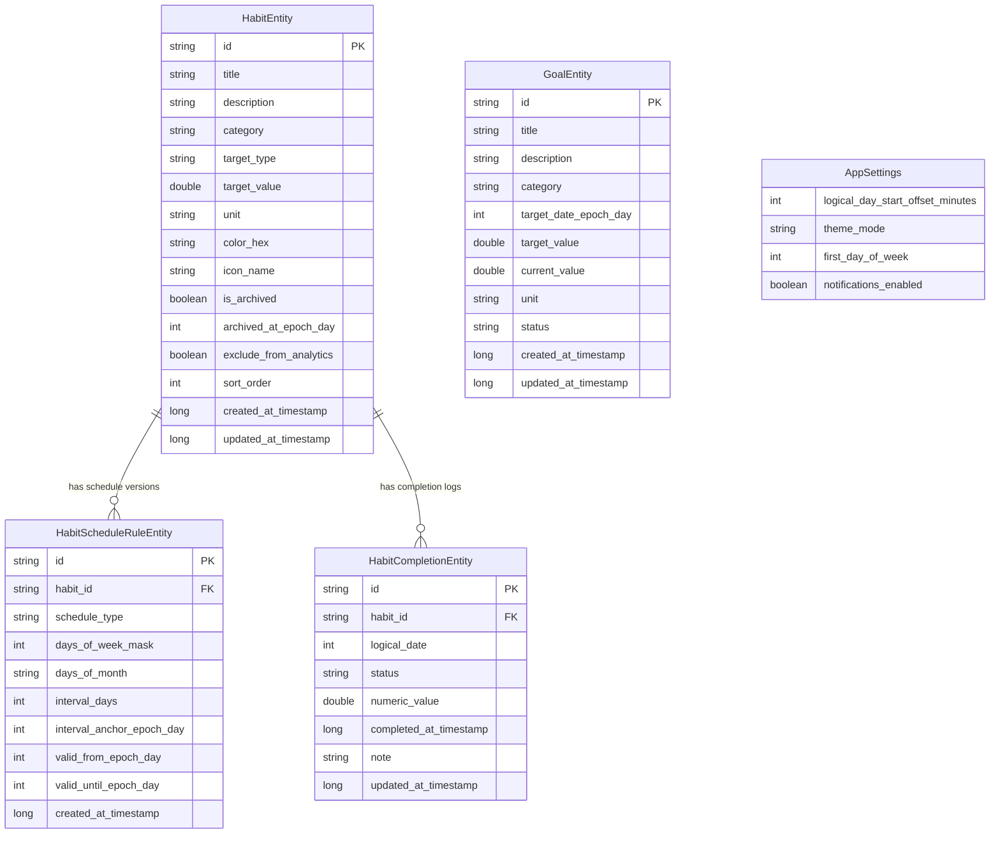

# Предложение по Архитектуре Данных и Доменной Модели Rawaq

## 1. Принципы Архитектуры

Проектирование локального хранилища Rawaq основывается на следующих принципах:

1. **Offline-First и Единый Источник Истины (Single Source of Truth, SSOT)**:
   - Приложение работает полностью локально на базе **Room** и **Preferences DataStore**.
   - Реактивное отслеживание данных происходит через **Kotlin Coroutines Flow**.
   - Не существует локально-кешированных "счётчиков серии" (streaks) или флагов `isCompletedToday` в основной сущности привычки. Данные о выполнении хранятся строго как журнал событий, из которого аналитика вычисляется налету (на уровне SQL-запросов или Kotlin Domain logic).

2. **История выполнения как Журнал Неизменяемых Событий (Event Sourcing Light)**:
   - Отметки выполнения привычки — это отдельные записи в таблице `habit_completions`.
   - Записи выполнения связываются не с физическим штампом времени в качестве ключа, а с **логическим днём** (`logical_date` в формате Epoch Day).
   - База данных **не генерирует пустые записи выполнения на будущее или прошлое**. Отсутствие записи расценивается динамически при вычислении отчёта:
     - Для прошлых дней с действующим расписанием — как невведённый статус (по умолчанию пропущенный день);
     - Для будущих дней — как ещё не наступивший срок.

3. **Версионирование Расписания Привычки (Schedule Versioning)**:
   - Изменение расписания привычки (например, переход с "каждый день" на "3 раза в неделю") не должно менять требования и историю выполнения за прошлые дни.
   - Расписание вынесено в отдельную сущность `habit_schedule_rules` с указанием интервала действия (`valid_from_epoch_day` ... `valid_until_epoch_day`).

4. **Чёткая Декомпозиция Моделей**:
   - **Room Entities** (`data/local/entity/*`): отражают схемы таблиц SQLite (первичные и внешние ключи, индексы, каскады).
   - **Domain Models** (`domain/model/*`): чистые Kotlin data-классы без аннотаций Room, используемые в бизнес-логике.
   - **Aggregated / UI Models** (`feature/*/model/*`): скомпонованные состояния UI (например, привычка + статус выполнения на конкретный логический день).

---

## 2. ER-Диаграмма Связей (Mermaid)



---

## 3. Описание Сущностей и Полей

### 3.1 `HabitEntity` (Привычка)
- **Назначение**: Хранение основных метаданных привычки (название, цель, категория, статус архивации).
- **Первичный ключ**: `id` (`String`, UUID).
- **Поля**:
  - `id`: `String` (PK) — уникальный идентификатор.
  - `title`: `String` — название привычки (например, "Чтение книги").
  - `description`: `String?` — опциональное описание/мотивация.
  - `category`: `String` — категория (например, "Здоровье", "Обучение", "Духовное").
  - `target_type`: `String` — тип цели: `"BINARY"` (да/нет) или `"NUMERIC"` (количественная).
  - `target_value`: `Double` — целевое значение за день (для BINARY = `1.0`, для NUMERIC = `10.0`, `2000.0` и т.д.).
  - `unit`: `String?` — единица измерения (`"страниц"`, `"мл"`, `"минут"`, `null` для бинарных).
  - `color_hex`: `String?` — цветовая плашка для UI.
  - `icon_name`: `String?` — иконка привычки.
  - `is_archived`: `Boolean` — флаг архивации (по умолчанию `false`).
  - `archived_at_epoch_day`: `Int?` — логический день, с которого привычка архивирована.
  - `exclude_from_analytics`: `Boolean` — исключить ли привычку из расчёта аналитики (по умолчанию `false`).
  - `sort_order`: `Int` — порядок сортировки в списке.
  - `created_at_timestamp`: `Long` — физический timestamp создания (UTC ms).
  - `updated_at_timestamp`: `Long` — физический timestamp последнего редактирования.
- **Индексы**: `index(category)`, `index(is_archived)`.

### 3.2 `HabitScheduleRuleEntity` (Версия Расписания Привычки)
- **Назначение**: Задание правил расписания (каждый день, дни недели, дни месяца, интервал) с версионированием по датам.
- **Первичный ключ**: `id` (`String`, UUID).
- **Внешний ключ**: `habit_id` -> `HabitEntity.id` (`ON DELETE CASCADE`).
- **Поля**:
  - `id`: `String` (PK).
  - `habit_id`: `String` (FK).
  - `schedule_type`: `String` — тип расписания: `"DAILY"`, `"WEEKLY_DAYS"`, `"MONTHLY_DAYS"`, `"INTERVAL"`, `"PAUSED"`.
  - `days_of_week_mask`: `Int?` — битовая маска дней недели (1=Пн, 2=Вт, 4=Ср, 8=Чт, 16=Пт, 32=Сб, 64=Вс). Пример: Пт = 16, Пн+Ср+Пт = 1+4+16 = 21.
  - `days_of_month`: `String?` — дни месяца через запятую (например, `"1,15,30"`).
  - `interval_days`: `Int?` — шаг интервала в днях (например, `2` для "каждые 2 дня").
  - `interval_anchor_epoch_day`: `Int?` — базовая дата (Epoch Day) для отсчёта интервала.
  - `valid_from_epoch_day`: `Int` — логический день, с которого действует эта версия расписания (включительно).
  - `valid_until_epoch_day`: `Int?` — логический день, до которого действует эта версия (включительно). `null` означает "действует бессрочно".
  - `created_at_timestamp`: `Long`.
- **Индексы**: `index(habit_id, valid_from_epoch_day)`.

### 3.3 `HabitCompletionEntity` (Запись о Выполнении)
- **Назначение**: Фиксация фактического выполнения/отмены/частичного выполнения привычки за конкретный логический день.
- **Первичный ключ**: `id` (`String`, UUID).
- **Внешний ключ**: `habit_id` -> `HabitEntity.id` (`ON DELETE CASCADE`).
- **Ограничения (Unique Constraint)**: UNIQUE(`habit_id`, `logical_date`). На один логический день для одной привычки может существовать не более одной записи выполнения.
- **Поля**:
  - `id`: `String` (PK).
  - `habit_id`: `String` (FK).
  - `logical_date`: `Int` — Epoch Day (количество дней с 1970-01-01 по логическому календарю приложения).
  - `status`: `String` — статус выполнения: `"COMPLETED"`, `"PARTIAL"`, `"SKIPPED"`, `"CANCELLED"`.
  - `numeric_value`: `Double` — фактически введённое количество (например, 6 из 10 страниц).
  - `completed_at_timestamp`: `Long` — точный физический timestamp момента сохранения (`System.currentTimeMillis()`).
  - `note`: `String?` — опциональная заметка/комментарий к дню.
  - `updated_at_timestamp`: `Long`.
- **Индексы**: UNIQUE `index(habit_id, logical_date)`, `index(logical_date)`.

### 3.4 `GoalEntity` (Цель)
- **Назначение**: Хранение среднесрочных и долгосрочных личных целей, не привязанных к ежедневному трекеру.
- **Первичный ключ**: `id` (`String`, UUID).
- **Поля**:
  - `id`: `String` (PK).
  - `title`: `String` — название цели.
  - `description`: `String?` — детальное описание.
  - `category`: `String?` — категория.
  - `target_date_epoch_day`: `Int?` — дедлайн цели в формате Epoch Day.
  - `target_value`: `Double` — целевой показатель (например, `5.0` книг).
  - `current_value`: `Double` — текущий прогресс (например, `2.0` книги).
  - `unit`: `String?` — единица измерения (`"книг"`, `"км"`, `"джузов"`).
  - `status`: `String` — статус цели: `"IN_PROGRESS"`, `"COMPLETED"`, `"ARCHIVED"`.
  - `created_at_timestamp`: `Long`.
  - `updated_at_timestamp`: `Long`.
- **Индексы**: `index(status)`.

### 3.5 `AppSettings` (Настройки Приложения — DataStore Preferences)
- **Назначение**: Хранение пользовательских конфигураций приложения.
- **Хранилище**: Preferences DataStore (`app_settings.pb` / `preferences_keys`).
- **Ключи**:
  - `logical_day_start_offset_minutes`: `Int` — смещение начала логического дня относительно 00:00 в минутах (например, `180` = 03:00 ночи; `0` = 00:00).
  - `theme_mode`: `String` — `"LIGHT"`, `"DARK"`, `"SYSTEM"`.
  - `first_day_of_week`: `Int` — `1` (Понедельник) или `7` (Воскресенье).
  - `notifications_enabled`: `Boolean` — включены ли напоминания.

---

## 4. Правила Расписаний и Версионирования

При создании привычки автоматически создаётся первая запись в `habit_schedule_rules` с `valid_from_epoch_day = current_logical_date` и `valid_until_epoch_day = null`.

### 4.1 Алгоритм изменения расписания:
Когда пользователь меняет расписание привычки в логический день $N$:
1. Находим текущее активное правило расписания для привычки (где `valid_until_epoch_day IS NULL`).
2. Если `valid_from_epoch_day == N` (расписание меняется в день его создания), мы просто обновляем текущую запись.
3. В противном случае:
   - Обновляем текущую запись: `valid_until_epoch_day = N - 1`.
   - Создаём новую запись `HabitScheduleRuleEntity` с `valid_from_epoch_day = N`, `valid_until_epoch_day = null` и новыми параметрами расписания.

### 4.2 Определение применимости привычки в логический день $D$:
Привычка с `habit_id` **должна выполняться (isDue)** в день $D$, если соблюдены ВСЕ условия:
1. $D \ge \text{habit.created\_at\_epoch\_day}$
2. Привычка не архивирована ДО дня $D$ (т.е. `is_archived == false` ИЛИ $D < \text{archived\_at\_epoch\_day}$).
3. Найдёно правило расписания, где $D \ge \text{valid\_from\_epoch\_day}$ И ($D \le \text{valid\_until\_epoch\_day}$ ИЛИ `valid_until_epoch_day IS NULL`).
4. Найденое правило удовлетворяет условию типа расписания на день $D$:
   - `DAILY`: всегда `true`.
   - `WEEKLY_DAYS`: день недели для $D$ совпадает с битовой маской `days_of_week_mask`.
   - `MONTHLY_DAYS`: день месяца для $D$ входит в список `days_of_month`.
   - `INTERVAL`: `(D - interval_anchor_epoch_day) % interval_days == 0`.
   - `PAUSED`: всегда `false` (привычка на паузе).

---

## 5. Правила Исторических Данных

1. **Редактирование задним числом**:
   - Пользователь имеет право внести отметку за прошлый логический день $D$.
   - Выполняется UPSERT (Вставка/Обновление) в `habit_completions` по ключу `(habit_id, logical_date = D)`.

2. **Количественные привычки**:
   - При внесении `numeric_value < target_value` статус устанавливается в `"PARTIAL"`.
   - При внесении `numeric_value >= target_value` статус устанавливается в `"COMPLETED"`.
   - Пользователь может изменить ранее введённое значение (например, с 6 на 8 страниц). Запись обновляется в DB с перерасчётом статуса.

3. **Явный пропуск (`SKIPPED`) vs Отсутствие записи**:
   - Статус `SKIPPED` сохраняется в базу данных при явном нажатии пользователем "Пропустить день". Пропущенный день не сбрасывает серию (streak) в агрессивном режиме или сбрасывает по выбору пользователя, но явно отличается от забытого дня.
   - Отсутствие записи означает, что отметка не вносилась. Для прошлых дней отсутствие записи интерпретируется как невыполнение, но в базе запись **не создаётся**, экономится место и предотвращается загрязнение данных.

4. **Архивирование и Пауза**:
   - Архивирование: привычка перестаёт отображаться в экране "Сегодня", но вся история отметок в `habit_completions` сохраняется. В аналитике прошлые дни учитываются до дня архивации.
   - Пауза: создаётся новая версия расписания со `schedule_type = "PAUSED"`. Дни в периоде паузы не считаются ожидаемыми к выполнению (not due) и не портят аналитику выполнения.

---

## 6. Механизм Логического Дня

### 6.1 Формула вычисления
Логический день — это инвариантный целочисленный индекс дня (`Epoch Day`), рассчитываемый по локальному времени пользователя с учётом настраиваемого смещения начала суток.

$$\text{LogicalInstant} = \text{PhysicalTimestamp} - (\text{LogicalDayStartOffsetMinutes} \times 60 \times 1000)$$

`LogicalDate (EpochDay)` рассчитывается как дата `LocalDate` в текущей временной зоне пользователя для мгновения `LogicalInstant`, переведённая в количество дней от 1970-01-01 (`LocalDate.toEpochDay()`).

### 6.2 Пример при границе логического дня в 03:00 (смещение 180 минут)
- Событие A: `2023-11-02 00:30:00` (UTC+3).
  - Минус 180 минут -> `2023-11-01 21:30:00`.
  - Логическая дата: `2023-11-01` (Epoch Day = `19662`).
- Событие B: `2023-11-02 03:30:00` (UTC+3).
  - Минус 180 минут -> `2023-11-02 00:30:00`.
  - Логическая дата: `2023-11-02` (Epoch Day = `19663`).

### 6.3 Перемещение между часовыми поясами
- При перемещении смартфона в другой часовой пояс `completed_at_timestamp` хранит точный UTC-timestamp физического события.
- `logical_date` сохраняется как фиксированное значение `Int` (Epoch Day), определенное в момент совершения/отметки действия. Это предотвращает случайное смещение исторических отметок при перелетах.

---

## 7. Правила Расчёта Пропусков, Выполнения и Серий (Streaks)

### 7.1 Экран "Сегодня" (Today Screen)
1. Вычисляется текущий `current_logical_date`.
2. Из базы запрашиваются все неприостановленные и неархивированные на сегодня привычки, чьё расписание удовлетворяет `current_logical_date`.
3. Для каждой привычки выполняются LEFT JOIN с `habit_completions` по `logical_date = current_logical_date`.
4. Общий дневной прогресс `DailyProgress`:
   - `completedCount` = количество привычек со статусом `"COMPLETED"`.
   - `totalCount` = общее количество привычек, обязательных к выполнению в этот день (`isDueToday`).

### 7.2 Вычисление серии (Streak Days)
Серия вычисляется динамически алгоритмом:
1. Начинаем с `check_date = current_logical_date`.
2. Если за `check_date` привычка выполнена (`COMPLETED`), увеличиваем `streak++` и переходим к `check_date - 1`.
3. Если за `check_date` привычка не обязательна к выполнению (`not due` по расписанию) или явно пропущена (`SKIPPED`), `streak` не обнуляется, проверяем `check_date - 1`.
4. Если за `check_date` привычка обязательна к выполнению (`is due`), но запись отсутствует или статус `"CANCELLED"`:
   - Если `check_date == current_logical_date` (сегодняшний день ещё не закончен), пропускаем его и проверяем `yesterday`.
   - Если `check_date < current_logical_date`, серия прерывается (цикл завершается).

---

## 8. Примеры SQL-запросов для Room

### 8.1 Получение привычек и статуса выполнения на логический день (Today Screen Query)
```sql
SELECT 
    h.*,
    c.id AS completion_id,
    c.status AS completion_status,
    c.numeric_value AS actual_numeric_value,
    c.completed_at_timestamp AS completed_at
FROM habits AS h
INNER JOIN habit_schedule_rules AS r 
    ON h.id = r.habit_id 
    AND :targetEpochDay >= r.valid_from_epoch_day 
    AND (r.valid_until_epoch_day IS NULL OR :targetEpochDay <= r.valid_until_epoch_day)
LEFT JOIN habit_completions AS c 
    ON h.id = c.habit_id AND c.logical_date = :targetEpochDay
WHERE h.is_archived = 0 
  AND r.schedule_type != 'PAUSED'
ORDER BY h.sort_order ASC;
```

### 8.2 Агрегация аналитики за диапазон дат (Range Analytics Query)
```sql
SELECT 
    h.id AS habit_id,
    h.title AS habit_title,
    COUNT(CASE WHEN c.status = 'COMPLETED' THEN 1 END) AS completed_days,
    COUNT(CASE WHEN c.status = 'SKIPPED' THEN 1 END) AS skipped_days,
    COUNT(CASE WHEN c.status = 'PARTIAL' THEN 1 END) AS partial_days
FROM habits AS h
LEFT JOIN habit_completions AS c 
    ON h.id = c.habit_id 
    AND c.logical_date BETWEEN :startEpochDay AND :endEpochDay
WHERE h.exclude_from_analytics = 0
GROUP BY h.id;
```

---

## 9. Индексы и Ограничения

1. **Таблица `habits`**:
   - Primary Key: `id` (`TEXT`)
   - Index: `index_habits_is_archived` на `(is_archived)`
   - Index: `index_habits_category` на `(category)`

2. **Таблица `habit_schedule_rules`**:
   - Primary Key: `id` (`TEXT`)
   - Foreign Key: `habit_id` REFERENCES `habits(id)` ON DELETE CASCADE
   - Index: `index_schedule_rules_habit_validity` на `(habit_id, valid_from_epoch_day, valid_until_epoch_day)`

3. **Таблица `habit_completions`**:
   - Primary Key: `id` (`TEXT`)
   - Foreign Key: `habit_id` REFERENCES `habits(id)` ON DELETE CASCADE
   - **Unique Index**: `index_completions_habit_date_unique` на `(habit_id, logical_date)` **UNIQUE**
   - Index: `index_completions_logical_date` на `(logical_date)`

4. **Таблица `goals`**:
   - Primary Key: `id` (`TEXT`)
   - Index: `index_goals_status` на `(status)`

---

## 10. План Миграций Room

### Версия 1 (Initial Release):
- Создание всех 4 таблиц (`habits`, `habit_schedule_rules`, `habit_completions`, `goals`) с указанными индексами и уникальными ограничениями.

### Стратегия будущих миграций:
- Все изменения схем в будущем должны быть покрыты тестами миграций (`MigrationTestHelper`).
- Новые поля добавляются через `ALTER TABLE` с default значениями или AutoMigration, если поддерживает Room.

---

## 11. Разбор 12 Контрольных Сценариев

Ниже описано поведение спроектированной модели для каждого из 12 сценариев:

1. **Создание ежедневной привычки 1 ноября**:
   - В `habits` создаётся запись с `id = H1`.
   - В `habit_schedule_rules` создаётся запись с `schedule_type = 'DAILY'`, `valid_from_epoch_day = 19662` (1 нояб), `valid_until_epoch_day = null`.
2. **Отметка выполнения 1 ноября**:
   - В `habit_completions` вставляется запись `(habit_id = H1, logical_date = 19662, status = 'COMPLETED')`.
3. **Внесение отметки за 31 октября задним числом**:
   - Запрос проверяет дату создания привычки. Если разрешено внесение до даты создания — вставляется запись `(habit_id = H1, logical_date = 19661, status = 'COMPLETED')`. Записи за 1 ноября и другие дни остаются неизменными.
4. **5 ноября изменение расписания с ежедневного на Пн, Ср, Пт**:
   - 5 ноября имеет Epoch Day = 19666.
   - Правило 1 обновляется: `valid_until_epoch_day = 19665` (4 нояб).
   - Создаётся Правило 2: `schedule_type = 'WEEKLY_DAYS'`, `days_of_week_mask = 21` (Пн+Ср+Пт), `valid_from_epoch_day = 19666`, `valid_until_epoch_day = null`.
5. **История за 1–4 ноября остаётся корректной**:
   - При запросе отчёта за 1–4 ноября система использует Правило 1 (`DAILY`). Все исторические дни рассчитываются как ежедневные.
6. **10 ноября привычка временно приостанавливается**:
   - 10 ноября = 19671.
   - Правило 2 обновляется: `valid_until_epoch_day = 19670`.
   - Создаётся Правило 3: `schedule_type = 'PAUSED'`, `valid_from_epoch_day = 19671`.
7. **15 ноября привычка возобновляется**:
   - 15 ноября = 19676.
   - Правило 3 обновляется: `valid_until_epoch_day = 19675`.
   - Создаётся Правило 4: `schedule_type = 'WEEKLY_DAYS'`, `days_of_week_mask = 21`, `valid_from_epoch_day = 19676`, `valid_until_epoch_day = null`.
8. **20 ноября привычка архивируется**:
   - В `habits` устанавливается `is_archived = true`, `archived_at_epoch_day = 19681`.
9. **История до архивации доступна, будущие дни не становятся пропусками**:
   - Записи до 20 ноября читаются из `habit_completions`. Начиная с 20 ноября фильтр `is_archived` исключает привычку из экрана Today и из требований к выполнению.
10. **Количественная привычка (цель 10 стр), прочитано 6**:
    - В `habit_completions` вставляется запись с `numeric_value = 6.0`, `status = 'PARTIAL'`.
11. **Пользователь исправляет значение с 6 на 8**:
    - Через UPSERT запись в `habit_completions` обновляется: `numeric_value = 8.0`, `status = 'PARTIAL'`, `updated_at_timestamp = System.currentTimeMillis()`.
12. **Смена логического дня с 00:00 на 03:00**:
    - В `AppSettings` меняется `logical_day_start_offset_minutes = 180`. Ранее записанные в DB отметки имеют инвариантный `logical_date` (Epoch Day) и не смещаются. Все новые события рассчитываются с новым офсетом.

---

## 12. План Тестирования

1. **Unit-тесты бизнес-логики (Domain Layer)**:
   - Расчёт `logical_date` при разных смещениях (00:00, 03:00) и в граничные моменты времени (02:59:59 vs 03:00:01).
   - Расчёт маски дней недели (`days_of_week_mask`).
   - Проверка расчета серий (streaks) при наличии пропущенных дней (`SKIPPED`) и неотмеченных дней.
   - Выбор правильной версии расписания (`HabitScheduleRuleEntity`) на историческую дату.

2. **Integration / DAO тесты (Room Unit Tests)**:
   - Проверка работы `UNIQUE(habit_id, logical_date)` — вставка дубликата должна вызывать конфликт / замену (REPLACE/UPSERT).
   - Проверка каскадного удаления (`ON DELETE CASCADE`) при удалении привычки.
   - SQL-запросы фильтрации активных привычек на конкретную дату.

---

## 13. Нерешённые Вопросы и Компромиссы

1. **Тип хранения `logical_date`**: `Int` (Epoch Day) выбран вместо `String` ("2023-11-01").
   - *Плюсы*: Минимальный размер индекса в SQLite, мгновенная сортировка, простые операторы `BETWEEN start AND end`.
   - *Минусы*: Для отображения в UI требуется форматирование через `LocalDate.ofEpochDay(epochDay)`.

2. **Обработка удаления привычки**:
   - Применяется Soft Delete (архивация `is_archived = true`). Hard Delete возможен только по явному желанию пользователя очистить данные.

3. **Разделение версий (MVP vs Future)**:
   - **MVP (Фаза 2 implementation)**:
     - Поддержка `DAILY`, `WEEKLY_DAYS` расписаний.
     - Хранение `habits`, `habit_schedule_rules`, `habit_completions`, `goals`.
     - Настройка смещения логического дня (`logical_day_start_offset_minutes`).
     - Вычисление статистики и серии (streak) налету.
   - **Будущие фазы**:
     - Сложные `INTERVAL` и `MONTHLY_DAYS` расписания.
     - Интеграция локальных уведомлений WorkManager.
